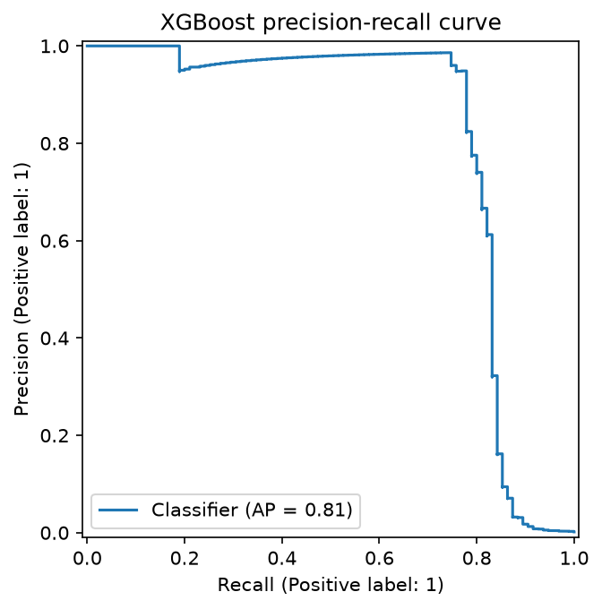

# Credit Card Fraud Detection

End-to-end fraud detection on highly imbalanced data using Python, scikit-learn and XGBoost, with a cost-based decision threshold.

## Business Problem
A bank loses money on fraudulent card transactions, but blocking genuine customers causes complaints and extra review work. The goal is to catch as much fraud as possible while keeping false alarms manageable, and to choose the decision rule using business cost rather than accuracy.

## Dataset
- Source: [Credit Card Fraud Detection (ULB) on Kaggle](https://www.kaggle.com/datasets/mlg-ulb/creditcardfraud)
- 284,807 transactions, 492 frauds (0.173%)
- Columns: `Time`, `Amount`, `V1-V28` (PCA-anonymised), `Class` (1 = fraud)
- Limitation: V1-V28 are anonymised, so features cannot be explained in business terms. The currency is not specified.
- The CSV is not included in this repo. Download it and place it at `data/creditcard.csv`.

## Approach
1. **EDA:** class imbalance, missing values, fraud vs normal amounts.
2. **Cleaning:** removed 1,081 exact duplicate rows (19 were fraud) to avoid the same transaction appearing in both train and test. The dataset has no transaction ID, so duplicates could not be verified as genuine repeats. Final data: 283,726 rows, 473 frauds (0.167%).
3. **Split:** 80/20 stratified split (test set: 56,746 rows, 95 frauds). `Amount` scaled using statistics from the training set only.
4. **Models:** Logistic Regression baseline, class weights, SMOTE (training data only), XGBoost.
5. **Metrics:** Precision, Recall, F1 and PR-AUC. Accuracy is not used because a "never fraud" model scores about 99.8%.
6. **Threshold tuning:** compared decision thresholds using assumed costs for false alarms and missed frauds, then tested how the best threshold changes with those costs.

## Results (default 0.5 threshold)

| Model | Precision | Recall | F1 | PR-AUC |
|-------|-----------|--------|----|--------|
| Logistic Regression (baseline) | 0.851 | 0.600 | 0.704 | 0.690 |
| Logistic Regression + class weights | 0.056 | 0.874 | 0.105 | 0.672 |
| Logistic Regression + SMOTE | 0.053 | 0.874 | 0.101 | 0.673 |
| **XGBoost** | **0.892** | **0.779** | **0.831** | **0.810** |

## Key Insights
- **Balancing a weak model does not make it good.** Class weights and SMOTE raised recall from 0.60 to 0.87, but precision fell from 0.85 to about 0.05, so roughly 19 of every 20 alerts would be false. PR-AUC did not improve.
- **XGBoost improved the ranking itself** (PR-AUC 0.690 to 0.810), with both high precision and high recall.
- **Fraud is not simply large-amount.** Median fraud amount (9.25) is lower than median normal amount (22.00), so amount alone cannot detect fraud.
- **Threshold matters more than the default.** At threshold 0.10, XGBoost catches 79 of 95 frauds (83%) with 51 false alarms.

## Cost-Based Threshold Tuning
Cost = false alarms x 5 + missed frauds x (missed-fraud cost). All costs are **assumptions**, not real bank figures.

| Missed-fraud cost | Best threshold | False alarms | Missed | Total cost |
|---|---|---|---|---|
| 20 | 0.80 | 5 | 21 | 445 |
| 50 | 0.10 | 51 | 16 | 1,055 |
| 100 | 0.10 | 51 | 16 | 1,855 |
| 500 | 0.10 | 51 | 16 | 8,255 |
| 1,000 | 0.10 | 51 | 16 | 16,255 |

The best threshold flips from 0.80 to 0.10 once a missed fraud costs roughly 10x a false alarm. The key business input is the cost ratio, not the model.

## Business Impact
At threshold 0.10, the model catches 83% of fraud cases and 77.4% of fraud value (11,435.55 caught vs 3,330.76 missed). Missed frauds are larger on average (about 208 vs 145), so a value-weighted cost function could justify an even lower threshold.

## Limitations
- The test set has only 95 frauds, so each fraud caught or missed shifts recall by about 1 percentage point. Results are noisy.
- The threshold was tuned on the same test set used for reporting, which is slightly optimistic. A validation split or cross-validation would be more rigorous.
- Costs are assumed, and features are anonymised.
- `Time` is seconds since the first transaction, not clock time.

## Future Work
- Add Random Forest and compare it with XGBoost
- Tune the threshold on a validation set or with cross-validation
- Use amount-weighted costs
- Try PaySim, which has readable columns, for business-level feature insights

## How to Run
```bash
pip install -r requirements.txt
# download creditcard.csv from Kaggle into data/
jupyter notebook 01_eda.ipynb
```

## Tech Stack
Python, Pandas, NumPy, Matplotlib, scikit-learn, imbalanced-learn, XGBoost